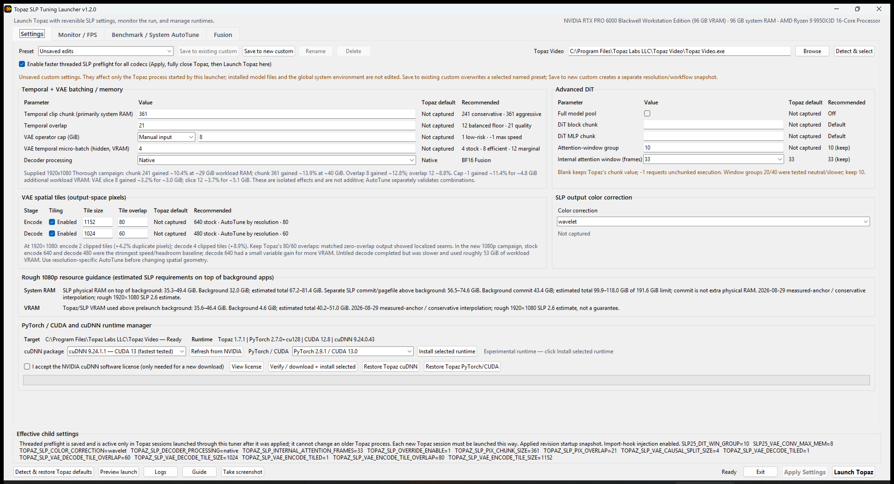
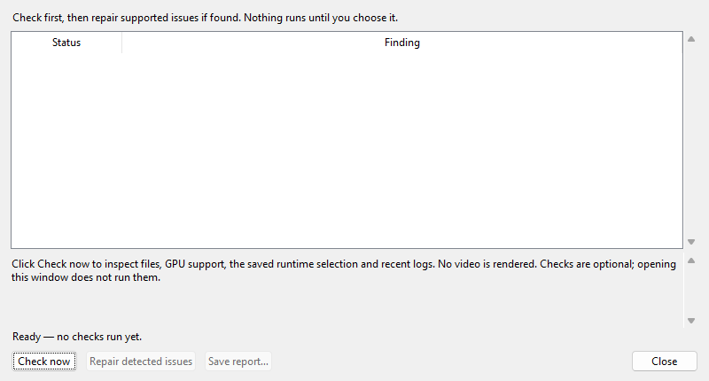
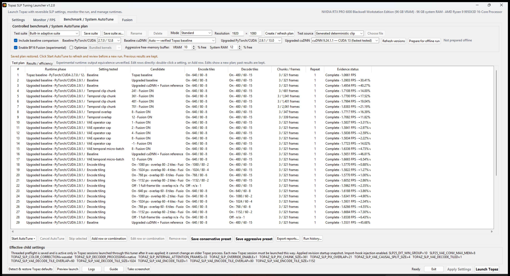
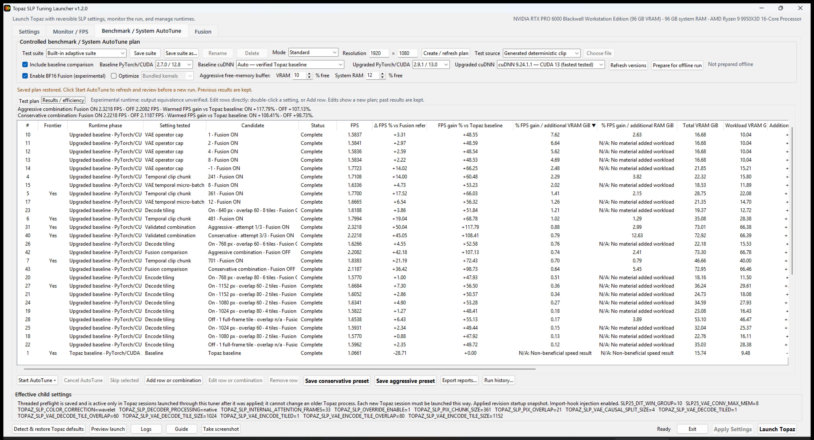
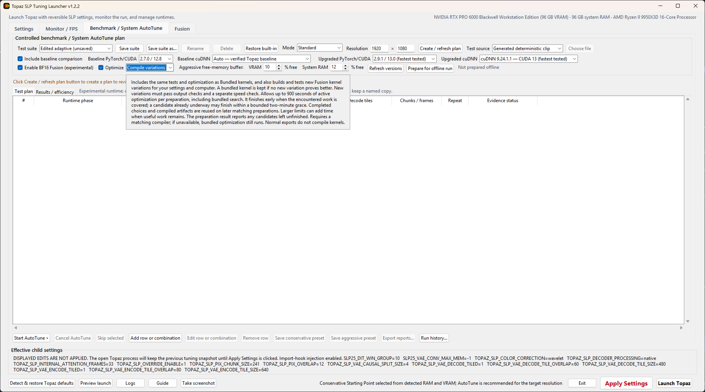
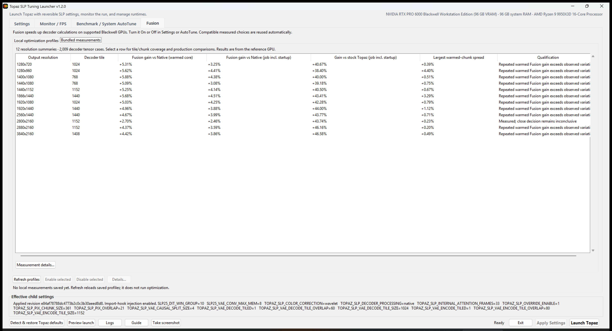
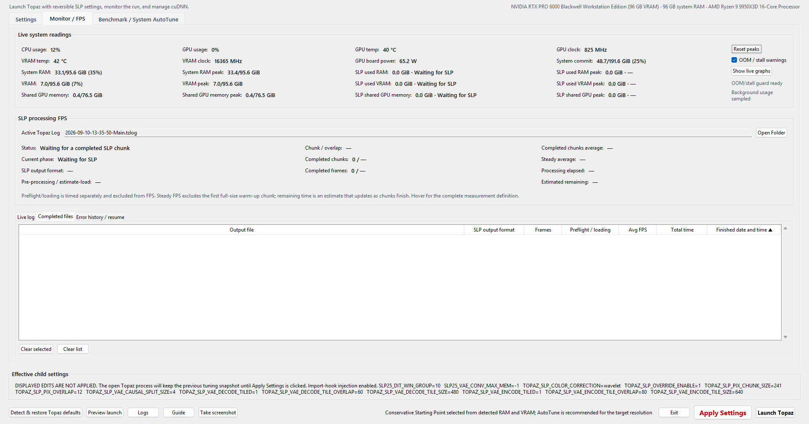
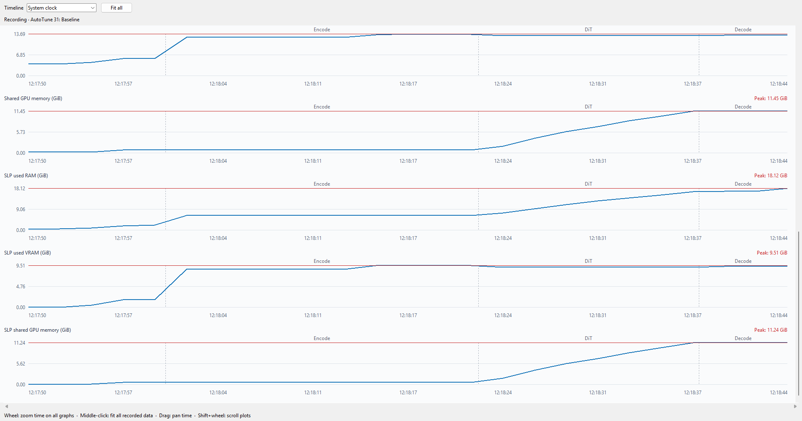
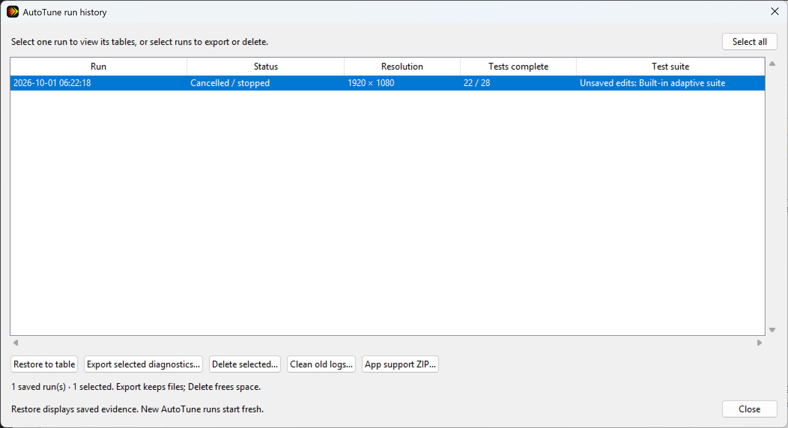
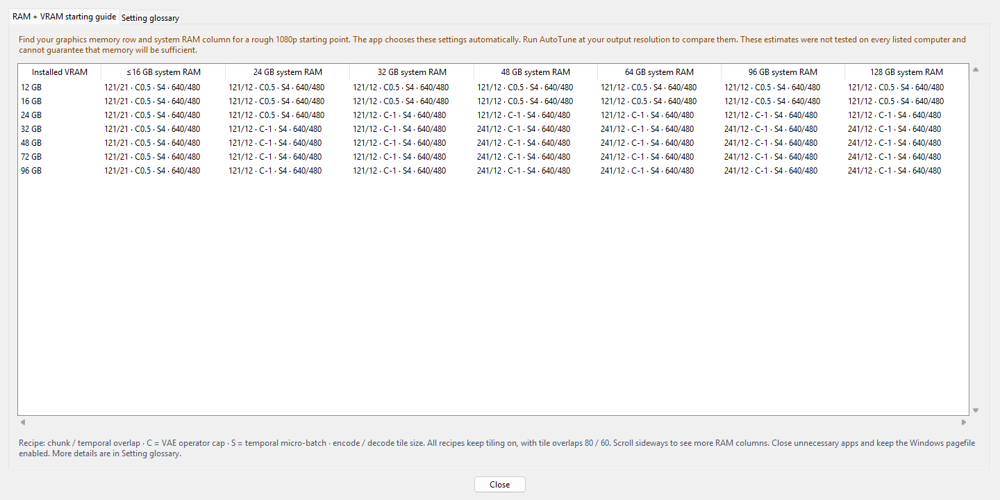

CHECKOUT MY NEW APP, SKV89'S SLP MANAGER, WHICH HAS MANY ADDITIONAL FEATURES AT https://github.com/skv89/Topaz-SLP-Manager

# Topaz SLP Tuning Launcher v1.2.2

Tune Topaz Video SLP 2.6, compare performance on your computer, and watch memory use while videos process—all from one portable Windows app.

[Published releases](https://github.com/skv89/Topaz-SLP-Launcher/releases/latest) · [Report a problem](https://github.com/skv89/Topaz-SLP-Launcher/issues)

## New in v1.2.2 — Better Fusion searches, AutoTune fixes and CLI presets

- **More time for useful Fusion optimization.** **Bundled kernels** allows up to **3 minutes** of active optimization per preparation. **Compile variations** allows up to **15 minutes**, including that same bundled search plus compiling and testing additional variations. Ordinary model loading and video processing no longer use up the search allowance.
- **Completed work carries forward.** Later matching preparations reuse compatible completed checks and verified compiled kernels. If time, memory or a compiler problem leaves candidates unfinished, they remain pending for a later matching run. A newly added candidate is treated as new work.
- **Comparison memory adapts to your available VRAM.** The optimizer compares candidate outputs in larger groups when memory is available and smaller groups when space is tight. Your output resolution, chunk size, tiles and output-check thresholds stay the same.
- **Support for growing Fusion collections.** Large libraries no longer omit profiles beyond the old 4,096-record limit. The existing Fusion list loads rows as needed, while exports continue to select compatible saved choices automatically.
- **Run saved presets from the command line.** List presets, run an existing batch script with a selected preset, or create a command-session setup file and exit. Each batch keeps its own settings and Fusion-profile snapshot, so later GUI edits do not change the next episode.
- **More reliable AutoTune startup.** A leftover default model/authentication folder from a different Topaz product no longer overrides the installation selected in the launcher. Custom model locations remain supported.
- **Clearer Fusion activity reports.** Check and repair Fusion now searches ordinary exports, AutoTune trials and CLI runs. A newer idle launch no longer hides completed work, and an older success does not hide a newer failure. Decoder Fusion and attention-window findings are reported separately.
- **Optional short Fusion test.** Use the arrow beside **Check now** to choose **Run short Fusion test**. It performs a small 17-frame export, checks actual Fusion kernel use and the completed output, and supports cancellation. The regular **Check now** action checks files and recorded activity without rendering video.
- **Repair more Fusion file problems.** **Repair detected issues** can restore a damaged compiled choice from an exact verified retained copy. If no suitable copy exists, that damaged choice is kept inactive so bundled Fusion remains available. Originals are backed up; valid profiles and user-disabled choices are retained.
- **Better support reports and folder-path handling.** Diagnostic exports include the failed startup worker's traceback when available, with private values redacted. Bundled Fusion kernels also load from deep Windows folder paths.

See the [Command-line guide](CLI_USAGE.md) for batch setup, examples and cancellation.

## Previously in v1.2.1 — Fusion compatibility and repair

- The cuDNN only test now supports an optional third baseline row with BF16 Fusion on the upgraded runtime. All three rows use the same baseline SLP settings; uncheck Fusion to keep the two-row comparison.
- Fixed missing output format, frame/chunk totals and remaining-time estimates in Monitor / FPS when Topaz omits its export-summary log entry. The monitor now also reads the active export command and matching worker log; FPS calculations are unchanged.
- AutoTune defaults to **PyTorch 2.9.1 / CUDA 13.0 / cuDNN 9.24.1.1**, with the upgraded runtime labeled **fastest tested**. Restoring old results at startup no longer resets the next-run runtime choices; later selections are remembered. Previous results and the Topaz baseline are preserved.
- BF16 Fusion help now has a separate troubleshooting paragraph directing you to **Check and repair Fusion…** when Fusion encounters issues or does not appear to improve speed.
- **Fusion works with compatible SLP 2.6 weight updates.** An otherwise supported decoder is no longer rejected solely because its loaded weights differ from the original benchmark build.
- **Check and repair Fusion…** sits beside **Refresh profiles** on the Fusion tab. It checks the launcher's Fusion files, saved profiles, GPU support, saved runtime selection and recent Fusion activity.
- **Repair detected issues** restores missing or damaged bundled Fusion files and disables corrupt local profile records while retaining originals. Valid profiles and compiled kernels are kept.
- Checks and repairs are **optional**. This update adds no mandatory diagnostic render or qualification step when opening Topaz or using Fusion. Settings help and Fusion error messages point to the new button.

**EXE-only update:** close Topaz and the launcher, replace the EXE, keep **Topaz-SLP-Launcher-Data**, then reopen the launcher and use **Launch Topaz**. Existing presets, compatible Fusion profiles, compiled kernels, runtime caches and history carry forward.

## Build your Fusion collection

**Gotta catch 'em all! Your tuning results carry forward.** Running AutoTune with Fusion optimization across a wider variety of output resolutions and SLP settings helps build a broader library of tested Fusion choices for your hardware. As that coverage grows, the app is more likely to have a faster compatible kernel ready to use automatically for future exports - including other not-yet tested but similar resolutions and settings that share matching internal workloads.
Compile variations includes the same bundled-kernel optimization and additionally builds and tests new variations. More relevant profiles increase the opportunity for better performance across a broader range of exports.

Some runs confirm an existing winner and help avoid repeated work. More profiles do not guarantee a speed gain on every export.

- **Choose your runtime:** Topaz Native **PyTorch 2.7.0 / CUDA 12.8**, or optional experimental **PyTorch 2.9.1 / CUDA 13.0**, with compatible cuDNN selection and a Restore Topaz PyTorch/CUDA button.
- **Optimize Fusion:** search the bundled choices, or choose **Compile variations** to include that same search and build/test additional variations. A bundled kernel stays selected when it performs better. New compiled winners must pass output checks and a separate speed confirmation.
- **Keep your collection:** view local choices, compiled kernels and retained timings in the Fusion tab. Compatible measurements guide future searches; matching validated choices are reused automatically.
- **Standard or Extended:** both derive conservative and aggressive presets and support optional Fusion optimization/compilation plus final Fusion On/Off comparisons. Standard stops at the first qualifying combination per preset and retries failures; Extended compares up to three candidates per preset, even after a success.
- **Clearer, roomier AutoTune:** grouped runtime selectors, more space for the tables, concise column/row help, and one warmed-FPS gain column against the recorded baseline.
- **Faster threaded preflight enabled by default:** new users start with it checked. Existing saved choices are preserved. Apply changes, fully close Topaz, then use Launch Topaz here.

These collection and AutoTune features were introduced in v1.2.0.

## Getting started

1. Download **Topaz-SLP-Launcher.exe**, or extract the portable ZIP into a writable folder. Open the EXE.
2. Detect & select the **Topaz Video** location.
3. Choose **Conservative Starting Point**, or **Stock Topaz** for no tuning overrides. Running Autotune is recommended.
4. Click **Launch Topaz**, then start an SLP export normally in Topaz.
5. Test a short duplicate clip at your intended output resolution before a long job.

Supports the tested Topaz Video **1.7.1** runtime layout and compatible earlier installations. Other builds, including betas, are checked for compatibility before tuning is applied; support for an unknown build is not guaranteed. Some installations need a one-time compatibility-helper setup, which can request Windows administrator approval. Replacing or restoring installed cuDNN also requires administrator approval.

To update, finish any active export, then exit Topaz and the launcher. Back up the old EXE and the **Topaz-SLP-Launcher-Data** folder before replacing the EXE. Keep the data folder in place to retain settings, presets, reports and cuDNN backups. Open the updated launcher and use **Launch Topaz** for subsequent SLP exports.

To return to an older version, restore its matching EXE and data-folder backup. Older versions do not understand the new Fusion settings and saved AutoTune plans.

Screenshots show an example computer, not recommended settings for every GPU. Settings, AutoTune and bundled Fusion views are captured from v1.2.0; Fusion optimization help is captured from v1.2.2; Check and repair Fusion is captured from v1.2.2 after its optional short test. The restored AutoTune tables retain an earlier run, including its original reference rows; they do not represent a new v1.2.0 benchmark. Other images illustrate unchanged features.

## Try experimental BF16 Fusion

Fusion combines selected decoder operations so the GPU can process them with fewer separate steps. It retains BF16 precision and does not change the model weights. Its effect on total export speed varies with the clip, resolution, GPU and other settings.

In **Settings**, choose **BF16 fusion (experimental)** under **Decoder processing**, click **Apply Settings**, then use **Launch Topaz** for your next SLP export. Compare a short duplicate clip before a long job. Choose **Native** and apply it to return to normal decoder processing.

Fusion requires **GeForce RTX 50-series or RTX PRO Blackwell GPUs (sm120)**. **RTX 30/40-series are not supported.** GPU testing used an RTX PRO 6000 Blackwell. Bundled Fusion, local profile optimization and optional compilation support both offered PyTorch/CUDA runtimes. Compatibility is checked for the selected GPU, Topaz model and runtime. Other builds are not guaranteed. Unsupported or incompatible cases use Native fallback where possible; Fusion-required AutoTune tests can stop with an explanation. Bundled Fusion needs no compiler; optional compilation requires the selected runtime's matching Triton compiler.

### If Fusion does not start

Open **Fusion → Check and repair Fusion…**, beside **Refresh profiles**, and click **Check now**. The results explain file problems, GPU support, the saved runtime selection and recent recorded Fusion activity. The check does not render a video or run a benchmark. Opening the dialog does not start a check.

For an optional execution check, choose **Run short Fusion test** from the arrow beside **Check now**. It uses a small separate workload, supports Cancel, and leaves your preset unchanged. Close Topaz and other GPU work first. It confirms Fusion execution, not speed at every resolution.

If **Repair detected issues** becomes available, close Topaz and click it to restore damaged or missing bundled files, restore a damaged compiled choice from an exact retained copy, or keep an unrecoverable corrupt choice inactive. Originals are backed up in **Topaz-SLP-Launcher-Data/fusion-repair-backups**; valid profiles, compiled kernels and history are retained. Restart Topaz through the launcher afterward.

The button does not install drivers or runtimes or alter Topaz model files. When those need attention, the findings explain the next step. **Save report…** saves a local JSON report; nothing is uploaded. Review GPU details and local paths before sharing it.

**Experimental CUDA 13 limitation:** complete-export equivalence and repeatability remain unverified. Decoder-operation output checks passed, but repeated short exports varied even with bundled Fusion alone. Compare a short export before production use. Compilation can improve an individual operation without producing a measurable whole-export improvement.

The separate **Internal attention window** controls how many frames the model considers together. **33** is the default; **121** is experimental, can use more memory and may change the result. It is independent of Fusion. Test output quality before adopting it.

## PyTorch / CUDA and cuDNN

In **Settings**, choose an installation mode, PyTorch/CUDA runtime and matching cuDNN package, then click **Install / update runtime**. One button handles both selections. The installed choice is remembered when the launcher reopens. Fully close Topaz before installing or restoring; existing sessions must be restarted.

- **Launcher only:** use the selected runtime when starting Topaz through **Launch Topaz**. The tuner can close afterward.
- **Permanent (experimental):** install the selected runtime inside Topaz so it also works when Topaz is opened directly. Installation happens once, with no repeated installation for videos or chunks. Original files are retained for **Restore Topaz PyTorch/CUDA** and Native AutoTune baselines. Other models may need additional compatibility changes; if issues occur, restore the original runtime.

Downloads are pinned and verified. Runtime caches, presets and Fusion profiles remain in **Topaz-SLP-Launcher-Data**. Switching a dropdown alone does not change the installed runtime.

**Restore Topaz cuDNN** restores Topaz's original cuDNN from its verified backup. New cuDNN downloads require accepting NVIDIA's license; installing or restoring files inside Topaz can require administrator approval. The **fastest tested** label for cuDNN **9.24.1.1 on CUDA 12 and CUDA 13** describes a reported comparison, not a universal ranking.

AutoTune offers separate **Baseline PyTorch/CUDA + cuDNN** and **Upgraded PyTorch/CUDA + cuDNN** choices. These test selections are independent of the runtime chosen for ordinary exports. The same cuDNN version can be compared across different PyTorch/CUDA runtimes. CUDA 13 needs a compatible NVIDIA driver; a faster result is not guaranteed.

## Find settings for your computer

Open **Benchmark / System AutoTune**, choose your output resolution and **Standard** mode, then click **Create / refresh plan**. The built-in adaptive suite uses your installed memory and selected output dimensions to generate its setting tests before the run. It does not require previous results or a preliminary benchmark. Saved custom suites keep your edits.

Add, edit or remove tests if desired and save your suite. Prepare the selected runtimes if prompted, then start AutoTune.

Leave Topaz open and idle, disconnect from the internet, keep the hardware running cool by leaving open windows, using AC, or running with an open case, and avoid using the computer during AutoTune as I found even light computer use such as typing documents or web browsing without videos can affect the performance significantly. Keep in mind individual-setting rows test a single parameter tweak, while custom-combination rows test all selected changes together. A result might differ by only a few percentage points; but if outside factors distorts the performance by a few percent, then the AutoTune results might not be reliable or useful. Saved tables remain available for reference; they do not resume processing.

### Compare Fusion with the baseline

Check **Enable BF16 Fusion (experimental)** before creating the plan. Fusion applies to the tuning rows and derived conservative/aggressive combinations. The Topaz baseline and upgraded baseline keep Fusion off. In Standard and Extended, the conservative and aggressive finalists each receive an identical-settings Fusion-off comparison. Identical combinations share work when both recorded memory limits pass.

The plan shows the later combination steps immediately. Their settings and clip lengths are derived after usable individual results exist; the pending entries do not claim measurements.

| Reference | What it measures |
|---|---|
| Topaz baseline | The first measured baseline row, with the selected Topaz runtime/cuDNN and Fusion off. Other runtime selections are labeled controlled baseline. |
| Upgraded baseline | The same baseline tuning settings with the selected upgraded PyTorch/CUDA and cuDNN, and Fusion off. |
| Upgraded cuDNN + Fusion reference | The same baseline tuning settings with the selected upgraded runtime and Fusion on. Individual Fusion-enabled tuning rows are compared with this reference. |

**Standard** keeps the reference at the end of the individual tests and omits the extra mid-suite and between-combination references. **Extended** retains nearby references to track performance changes. References use the same settings. The final conservative and aggressive summaries show Fusion ON and OFF FPS and each gain against the same Topaz baseline (or selected baseline).

**FPS gain % vs Topaz baseline** compares the two warmed chunks with the baseline row from this run. Other selected runtime baselines are labeled **controlled baseline**. Chunk 1 is discarded in Standard and Extended. Fusion On/Off compares the same full combination with only Fusion changed. Raw timing evidence remains available in exported data.

Fusion-enabled AutoTune adds reference and comparison rows, so it can take longer. Results are specific to your computer and test clip; they do not establish the fastest possible settings for every export.

**Quick runtime comparison:** choose **cuDNN only test**. Checking **BF16 Fusion** adds a third row: selected baseline with Native processing, upgraded runtime with Native processing, and upgraded runtime with BF16 Fusion. All rows use the same baseline SLP settings. Uncheck Fusion for two rows. This mode compares runtimes and Fusion without optimizing kernels or deriving presets.

### Test your own combination

Choose **Add row or combination**, select a combination and enter its settings. **Saved presets** fills the fields from an existing preset. When a completed AutoTune run is available, the next dropdown offers its conservative and aggressive recommendation choices; calculated alternatives remain labeled as estimates. Choose **BF16 Fusion: On** or **Off** independently of the suite checkbox. Saving the dialog immediately adds or updates the table. **Edit row or combination** changes an existing editable row. Hover over a combination row for its purpose and result; press F1 for all settings.

Use Ctrl or Shift to select several setting-test rows, then press Delete or choose **Remove selected rows**. One Ctrl+Z restores the entire removed group. Required baseline and reference rows remain protected. Removing all setting tests also clears the automatic combination steps.

To compare just a few ideas, select those rows and choose **Run selected tests** from the arrow beside **Start AutoTune**. The launcher includes the required Topaz and upgraded-cuDNN baseline comparisons automatically. This works on the first run; you do not need to finish a full suite or delete other rows. The normal **Start AutoTune** action still runs the full plan.

Custom combinations use the same live memory safeguards. Their measured results are treated as complete combinations, not as separate gains to add to other settings. A user-selected combination is not automatically a validated preset recommendation.

### Runtime checks before AutoTune

After the selected runtimes are prepared, AutoTune checks that each runtime needed by the plan can load before preparing test media or starting timed rows. A comparison run checks native and upgraded cuDNN. Loading checks are time-limited; the optional runtime gets extra time for first-use verification. A short real SLP request then checks the selected installation's model/authentication context before preparing long media. These checks occur when starting AutoTune, not when opening the launcher; they retain diagnostic evidence and leave installed DLLs unchanged.

AutoTune and CLI use the selected Topaz product's model/authentication context. An inherited default folder belonging to another Topaz product is ignored; custom definitions and separately configured model-data locations are preserved. This prevents an older **Topaz Video AI** installation's default folder from overriding a selected **Topaz Video** installation.

If a runtime cannot start, AutoTune stops before the benchmark rows and saves the diagnostic results. Open **Run history…** and use **Export selected diagnostics…** for that run. A passed startup check confirms loading, not that every setting will fit in memory or process successfully.

In **Standard** and **Extended**, AutoTune combines successfully tested settings and ranks the choices by predicted speed. Each choice must fit **both** the VRAM and system RAM buffers for its preset. Aggressive and conservative use their own limits. The isolated setting suite is not run again.

**Standard** stops at the first qualifying result per preset, retrying failures up to three attempts. It uses the end-of-individual-tests reference without extra combination baseline runs. **Extended** compares up to three candidates per preset, even if the first qualifies, and chooses the fastest qualifying result. Extended keeps nearby comparison references. Both modes test each individual setting once, retain three full chunks per scored row, and support optional **Bundled kernels** or **Compile variations** optimization plus final Fusion On/Off comparisons. Historical Thorough results retain their original three repetitions; new plans use Extended. **Complete** means rendering finished. A **RAM/VRAM buffer not met** label explains why a completed candidate cannot qualify for that preset. A successful conservative choice can also serve as the aggressive fallback. Only eligible tested results can be saved as recommendations. Hover over either Save preset button, or focus it and press **F1**, for the selection explanation and a table of the tested recommendation and up to two calculated alternatives. Calculated gains and memory totals are estimates; the alternatives are for information and are not saved by those buttons. The help identifies the capacities and buffers recorded for that run and flags differences from current hardware or edited inputs. It shows the winner's measured memory peaks separately from estimates. Older results are not recalculated when the inputs change.

The aggressive buffer fields accept decimal percentages from **0% up to the conservative buffer**. Press Enter or leave the field to commit an edit: a number above the limit becomes the limit, and a negative number becomes zero. Blank or nonnumeric entries return to the last valid value.

| Installed capacity | Recommended aggressive VRAM free | Conservative VRAM free | Recommended aggressive RAM free | Conservative RAM free |
|---|---:|---:|---:|---:|
| 16 GB and below | 7% | 15% | 12% | 20% |
| 24 GB | 7% | 15% | 12% | 20% |
| 32 GB | 7% | 15% | 12% | 25% |
| Above 32 GB | 10% | 20% | 12% | 30% |

VRAM and system RAM use their **own installed capacities** to select a row. Percentages reserve space from total memory, including Windows, Topaz and other applications. A real Topaz export can use more memory than the idle Topaz interface used during AutoTune; leave a larger buffer if needed. Lower buffers increase out-of-memory risk. Changing these fields affects new plans, not older saved results.

Candidate tests that stop reporting render progress are stopped automatically after at least **20 minutes**, with a longer allowance when successful baseline timing warrants it. Overall test deadlines remain finite. Baseline and model-loading phases have separate safeguards.

When a test reaches a memory safety limit, AutoTune stops that test and checks that its worker has closed and memory has recovered before advancing. An optional Topaz comparison may be skipped after recovery; comparisons with that missing baseline are then unavailable. The **upgraded baseline** is required to compare setting changes, so AutoTune stops if that reference cannot finish. Persistent memory pressure, missing required GPU readings, or unverified cleanup also stop the run and preserve completed results. Lowering a preset's free-memory buffer does not disable these safeguards.

A **RAM safety stop** means free physical system memory fell below the safety floor. A **commit safety stop** means Windows had too little remaining memory-commit capacity (backed by RAM and the pagefile). Commit can run low while the displayed physical RAM and VRAM still have room. Hover over a stopped result for the recorded values; closing memory-heavy applications or allowing more Windows-managed pagefile space may help.

Extended can reuse a recent comparable reference after brief memory failures; Standard uses its completed end-of-individual-tests reference. On eligible high-resolution systems, the adaptive plan can add a modest **161-frame chunk** test even when its initial memory estimate excludes larger chunks. That row still has to pass the same memory safeguards.

Combination recommendations include an allowance for background memory use. If a tested combination uses more memory than predicted, that measurement can tighten the estimates for the remaining comparable choices. Aggressive and conservative still use their own VRAM and system RAM limits.

Review **Results / efficiency**, save a validated preset, or use **Export reports…** for the PDF and result files. “Aggressive” is a speed-oriented choice, not a guarantee of the fastest possible settings. Use **Extended** to compare more combinations. Repeat an individual measurement when a surprising result needs confirmation.

Saved-run screenshots retain the original measurements. Their Fusion gains apply to those complete combinations; the baseline column uses warmed FPS. Performance varies by computer, video and resolution.

## Fusion profiles and measurements

Open **Fusion** to view bundled reference measurements or local optimization profiles. Exact GPU/software and tensor compatibility determines reuse; choosing the nearest output resolution alone is insufficient. Other supported Blackwell systems can measure their own choices with the optional final-combination stage. Their speed can differ from the reference workstation.

In AutoTune, enable **Optimize** beside BF16 Fusion:

| Method | What it does |
|---|---|
| **Bundled kernels** | Tests the included Fusion choices and saves the best confirmed choice for your settings and computer. No compiler is needed. |
| **Compile variations** | Does the same bundled search, **plus** compiles and tests additional variations from trusted templates. It can keep a bundled winner. New compiled choices need output checks and separate speed confirmation. Adds preparation time and requires a matching compiler. |

Normal exports never compile. A small helper inside Topaz's processing worker checks each actual decoder tensor and chooses a compatible saved profile; otherwise it uses the established bundled path. A change of output resolution does not blindly reuse the previous resolution's winner. Compatible internal shapes can share a profile even when they come from different output resolutions. The launcher window does not need to remain open for this selection during an ordinary export.

**Your tuning results carry forward.** Saved choices are reused when compatible. Stable measurements help order later searches, and a new shape is tested before a newly optimized choice is activated. Profiles are specific to the relevant GPU/software/tensor combination. Completed search evidence and verified compiled artifacts can be reused even when a bundled choice wins. Unfinished candidates remain pending for a later matching preparation. Disabling a profile keeps its record and affects newly started workers.

Fusion preparation rows gather these measurements; they deliberately have no export FPS. Turn off **Optimize** to skip preparation while keeping bundled Fusion. **Bundled kernels** allows up to **180 seconds (3 minutes)** of active optimization per preparation. **Compile variations** allows up to **900 seconds (15 minutes)** in total, including bundled search. These are ceilings: a search that finishes in 50 seconds does not wait for the remaining time. Ordinary model loading and video processing are separate from the optimization allowance, so the complete preparation can take longer. A candidate already underway may finish within a bounded two-minute grace. An unavailable compiler still permits bundled optimization.

The result reports encountered workloads, completed or reused candidates, and anything left pending because of time, memory or compilation problems. These limits do not guarantee that every workload will finish on every computer. Saved compatible work reduces later preparation; a newly added candidate is recorded as new work. Increasing the allowance can add time when useful searches remain, but does not extend a search that is already finished. Scored rows keep fixed choices and do not optimize or compile.

Comparison workspace means temporary memory used to compare a candidate kernel's output with its reference. The optimizer adapts the amount compared at once to actual free VRAM; it does not reduce your resolution, chunk size, tiles or output-check thresholds. Compiled choices still require complete output comparison and a separate speed confirmation. A growing library adds disk and indexing work, but does not make every historical compiled file another GPU search candidate.

**Reading the library:** Native means ordinary decoder processing; Bundled means the included Fusion path; Local means a measured selection from included variants; Tailored means a validated variation compiled on your computer. Kernel gain measures one decoder operation, not the whole video. Combination Fusion gain compares the full settings with Fusion On and Off. Several tensor rows may share that same combination result. Hover over headings or press F1 for details.

### The bundled starting point

The development campaign screened **60 output-resolution/decoder-tile combinations across 12 output resolutions**. Later production testing added **1920×1080 with a 1152-pixel decoder tile**, for **61 distinct pairs**. These generated the shapes used to build a library of **2,009 measured internal decoder tensor configurations**.

The app includes **7 bundled Fusion variants implemented by 105 precompiled GPU kernel files**. Files include shared processing stages and shape-specific versions; they are not 105 independent algorithms. Your own optimization and compilation runs add the profiles and measurements most relevant to your output resolutions, SLP settings and system hardware.

| Output resolution | Decoder tile sizes screened | Pairs |
|---|---|---:|
| 1280x720 | 480, 640, 720, 1024 | 4 |
| 1280x960 | 480, 512, 640, 768, 960, 1024 | 6 |
| 1400x1080 | 480, 512, 640, 768, 1024, 1080 | 6 |
| 1440x1080 | 480, 640, 768, 1024, 1080 | 5 |
| 1920x1080 | 480, 640, 768, 1024, 1080 | 5 |
| 1440x1152 | 480, 640, 768, 1024, 1152 | 5 |
| 1866x1440 | 480, 640, 768, 1024, 1440 | 5 |
| 1920x1440 | 480, 640, 768, 1024, 1440 | 5 |
| 2560x1440 | 480, 640, 768, 896, 1408, 1440 | 6 |
| 2800x2160 | 480, 640, 1024, 1152 | 4 |
| 2880x2160 | 480, 640, 1024, 1152 | 4 |
| 3840x2160 | 480, 640, 1024, 1152, 1408 | 5 |

The extra 1920×1080 / 1152 pair comes from later production checks. Full-video On/Off comparisons covered selected settings, **not every possible combination** of resolution, chunk, overlap and tiling. Bundled measurements remain available as reference results, not a speed promise for other computers.

## Monitor your videos

**Monitor / FPS** shows CPU/GPU activity, temperatures, power and memory, plus processing progress and completed files.

Live readings update automatically every **five seconds**, including VRAM temperature where supported. **Reset peaks**, **OOM / stall warnings** and **Show live graphs** sit beside the readings. “Background usage sampled” means the launcher recorded memory use while SLP was idle, so it can estimate the extra memory used by SLP.

Ordinary low-VRAM warnings use a remaining-memory threshold of **0.8 GiB on 16-GB cards** and **1 GiB on 24-GB cards**. Uncheck **OOM / stall warnings** to disable those launcher popups; the preference is saved immediately. AutoTune's automatic safeguards remain active.

**Completed chunks average** includes all finished chunks. **Steady average** excludes the first full-size warm-up chunk and a short final chunk. Neither includes pre-processing/loading.

**Completed files** lists finished exports, not queued or currently processing videos. Right-click a completed entry to open its file or folder, or restore its verified settings. If the original settings are unavailable, the entry remains visible but **Load settings** is disabled. Missing output-format details and measurements are shown as unavailable.

Click **Show live graphs** to compare readings. The mouse wheel zooms time on all graphs together; middle-click fits the full timeline. Use the scrollbar or **Shift+wheel** to scroll through the plots. Memory peaks are marked in red, and phase labels appear when there is room to read them.

Graphs reuse the existing monitor readings. Each new SLP file replaces the previous graph history instead of accumulating graph files on disk.

## Share a problem or free disk space

Open **Run history…**:

- **Restore to table**: select one run to view its saved plan and results in the main GUI. Completed, failed and untested rows retain their original status. Restoring preserves the previous table and does not apply settings or resume processing. A new full AutoTune run refreshes its plan for review before starting.
- **Export selected diagnostics…**: select the AutoTune runs you need help with. The ZIP includes runtime startup outcomes, native and upgraded cuDNN inventory metadata, test results, per-row logs and the launcher's recent log. GPU identity and counter-readiness diagnostics help explain missing telemetry. New runs also retain compact resource history and separate first-chunk/later-chunk timings. All rows are considered; failed, warning-bearing and unusually slow rows receive priority within the archive limits. The manifest identifies missing, truncated or omitted files. Older runs cannot supply measurements that were never recorded.
- **App support ZIP…**: use this for a general launcher problem—for example, an error when opening Topaz. No run selection is needed.
- **Delete selected…**: remove selected saved runs after reviewing the size and confirming.
- **Clean old logs…**: remove eligible older logs while keeping results, reports and failed-run evidence.

Exporting does not upload or delete anything. Diagnostic ZIPs are not full report backups; review them for private information before sharing. Deleting a run keeps original videos, presets and reports exported outside that run's folder.

## Help and requirements

The **Attention-window group** bundles attention windows for processing: **10** means handling ten windows together, not looking across ten more frames. **DiT MLP chunk** is a count of internal work items; **16384** does not mean 16,384 MB of VRAM. A smaller chunk may lower temporary VRAM use, but its speed effect is experimental and untested. Leave it blank to keep Topaz’s value.

Use **Ctrl+Z** to undo tuning parameter edits or AutoTune row edits/deletions. Hover over controls and dropdown options for explanations. **Guide** provides starting-point guidance and a setting glossary. The separate **Error history / resume** page for ordinary Topaz exports can reopen a failed source from the beginning; you confirm its export in Topaz. It does not resume an AutoTune campaign.

Requires **Windows x64**, a supported **Topaz Video installation with SLP 2.6**, and an **NVIDIA CUDA GPU**. No Python installation is needed. AutoTune and faster preflight require both FFmpeg and FFprobe; the selected Topaz installation should already provide them. You can also place **ffmpeg.exe** and **ffprobe.exe** together beside the launcher EXE (or in its **bin**, **ffmpeg**, or **ffmpeg/bin** subfolder). No system settings need to be changed. New cuDNN downloads require accepting NVIDIA's license.

**Important:** tuning is experimental. Settings that fit a 96-GB workstation may not fit a 16-GB GPU/32-GB RAM computer. Larger chunks, tiles and batches—or an uncapped VAE—can greatly increase memory use. Safety guards cannot prevent every OOM or driver failure. 

The app is unsigned, so Windows may show an unknown-publisher warning. Download only from this repository. This independent community tool is not endorsed by Topaz Labs or NVIDIA.

[License](LICENSE) · [Third-party notices](THIRD_PARTY_NOTICES.md)

The **Fusion** page explains an empty local library and links directly to bundled measurements. Local profiles are created by the optional final-combination optimization stage; **Refresh profiles** only reloads existing profiles. Bundled rows summarize complete comparisons at 12 resolutions. **Details** shows the tested tile/chunk settings and separate tensor coverage; it does not imply every possible combination received a full-video test.
